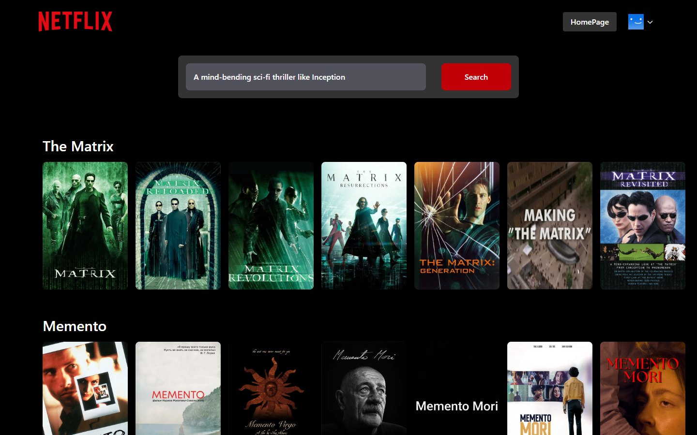

<div align="center">

# 🎬 Netflix GPT

**A Netflix clone where you describe what you want to watch — and AI finds it.**

React 19 · TypeScript · Vite · Tailwind CSS · Redux Toolkit · Firebase · Groq · TMDB

[Live Demo](https://netflixgpt-aa7a0.web.app) 


</div>

---

## Core Features

### 🤖 AI Movie Search
Type a natural prompt like *"a mind-bending sci-fi thriller like Inception"*. Groq's LLM returns 5 movie titles, which are then resolved to real TMDB movies with posters and ratings.

<div align="center">



<sub><b>GPT Search in action</b> — ask for anything in plain English and get five matching movies with real posters and ratings.</sub>

</div>

**How to search anything:**

1. Open the app and sign in.
2. Click **Gpt Search** in the top-right corner.
3. Type what you feel like watching — a genre, a mood, a plot, or a movie you liked (e.g. *"a funny movie for a family night"*).
4. Press **Search**. The AI picks 5 titles, and each one is shown as its own scrollable movie row.

### 🔐 Authentication
Email/password sign up and sign in with Firebase Auth, custom form validation, persistent sessions, protected routes, and a profile menu with sign out.

### 🎥 Netflix-Style Browsing
A cinematic hero with an auto-playing muted trailer, plus scrollable rows for Trending, Now Playing, Popular, Upcoming, and Horror movies.

### 📄 Movie Details & Trailers
A "More Info" modal showing backdrop art, rating, runtime, genres, and overview, plus a dedicated `/watch/:movieId` page with a full-screen trailer.

### 📱 Responsive Design
A dark, Netflix-inspired UI built with Tailwind CSS that works from small phones to large desktops.

---

## Run Locally

```bash
pnpm install
```

Add a `.env` file with your keys:

```env
VITE_TMDB_ACCESS_TOKEN=your_tmdb_token
VITE_GROQ_API_KEY=your_groq_key
```

Then start the dev server and open **http://localhost:5173**:

```bash
pnpm dev
```

> Firebase config lives in `src/utils/firebase.ts`. See the [detailed README](./README.detailed.md) for setup, routes, and deployment.

---

<div align="center">

Movie data by [TMDB](https://www.themoviedb.org/). Educational project — not affiliated with Netflix.

</div>
